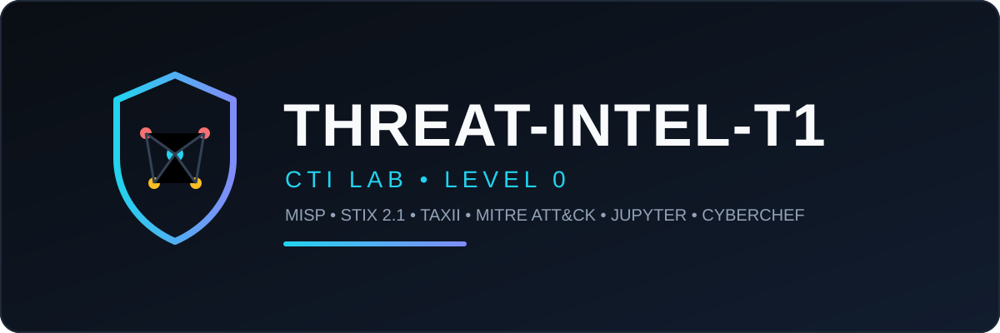

<p align="center">
  
</p>

# threat-intel-t1 — CTI Lab Level 0

Lightweight Cyber Threat Intelligence lab with Docker.
Build, store, and share IOCs using real CTI standards.

**Level 0 stack:** MISP + Jupyter (STIX 2.1 / TAXII / MITRE ATT&CK) + CyberChef
**Level 1 (next):** OpenCTI for correlation, graphing, and dashboards.

## Tools and what each does

**Infra (`docker-compose.yml`):**
- **MISP (`coolacid/misp-docker:core-latest`)** — core IOC store. Events + Attributes + Tags. UI/API on `http://localhost:8081` / `https://localhost:8443`
- **MariaDB (`mariadb:10.11`)** — backend DB for MISP
- **Redis (`redis:7-alpine`)** — cache + background jobs for MISP
- **Jupyter Lab (custom `Dockerfile.jupyter`)** — Python workspace for STIX/TAXII work, mounted from `./notebooks`
- **CyberChef (`ghcr.io/gchq/cyberchef`)** — decode / deobfuscate payloads before extracting IOCs, on `http://localhost:8000`

**Python libs (`Dockerfile.jupyter`):**
- `requests` — talk to MISP REST API
- `stix2` — build STIX 2.1 bundles (Indicator + Malware + Relationship)
- `taxii2-client` — query TAXII 2.x servers (MITRE)
- `pandas` — handle MITRE data as tables
- `pycti` — parsing helper, reserved for Level 1 OpenCTI

## The cycle

1. **Decode:** paste suspicious strings in CyberChef (`:8000`), extract IP / domain / hash
2. **Context:** map to MITRE ATT&CK (T1059, T1071, T1566) via live TAXII or cached `enterprise-attack.json`
3. **Store:** push to MISP as Event + Attributes via `notebooks/cti_misp_taxii_lab.py:115` `demo_misp_push()`
4. **Share:** build portable STIX 2.1 `Bundle` via `demo_stix_bundle()` → `notebooks/cti-push-bundle.json`
5. **Verify:** run `notebooks/test_cti_lab.py` (STIX build + MITRE fetch + MISP ping)

Flow: `CyberChef decodes → MITRE gives context → MISP stores → STIX shares`

## Quickstart

```bash
docker compose up -d --build
```

| Service | URL | Creds |
|---|---|---|
| MISP HTTP | http://localhost:8081 | set on first run |
| MISP HTTPS | https://localhost:8443 | self-signed, expect warning |
| Jupyter | http://localhost:8888 | token `ctilab` |
| CyberChef | http://localhost:8000 | none |

Set your MISP key (never commit it):

```bash
# PowerShell
$env:MISP_KEY="your-misp-api-key"
# bash
export MISP_KEY="your-misp-api-key"
```

Run the lab:

```bash
docker exec -it cti-jupyter python work/cti_misp_taxii_lab.py
python notebooks/test_cti_lab.py
```

Get MISP key from: MISP UI → Administration → Users → Auth Key.

## Repo structure

```
.
├── docker-compose.yml          # Level 0 stack
├── Dockerfile.jupyter          # Jupyter + stix2/taxii2-client/pandas/requests
├── notebooks/
│   ├── cti_misp_taxii_lab.py   # main flow: MISP push + TAXII pull + STIX build
│   ├── test_cti_lab.py         # env check
│   └── cti-push-bundle.json    # example STIX 2.1 output
└── .gitignore                  # excludes enterprise-attack.json (45MB, auto-downloaded)
```

`enterprise-attack.json` is not committed. `test_cti_lab.py` downloads it from MITRE CTI on first run.

## Test data

Safe lab IOCs only (TEST-NET, no live malware):
- `203.0.113.45`
- `evil-cti-example.com`
- `44d88612fea8a8f36de82e1278abb02f36f5ba38d69b3a3406f2323ea3a3c8b8`

## Level 1 roadmap

Add `docker-compose.opencti.yml` overlay: Elasticsearch + Redis + RabbitMQ + MinIO + OpenCTI server/worker/frontend.
Flow becomes: `MISP (source) → STIX bundle → OpenCTI (correlation + graph)`.
Level 0 stays runnable on ~2GB RAM. Level 1 needs 8-12GB.

## Notes

- Change default passwords in `docker-compose.yml` before any shared deployment.
- MISP HTTPS uses a self-signed cert in lab — `VERIFY_SSL=False` is lab-only.
